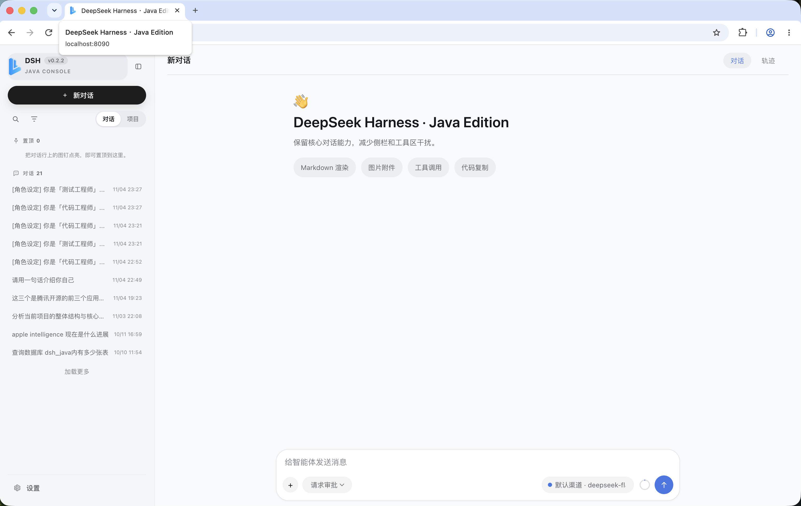

# dsh-java-release (0.2.2)

[中文](./README.md) | English

A ready-to-publish runtime environment for DSH Java 0.2.2 — download and run directly.

## Command Reference

| Command | Purpose | Common options |
| --- | --- | --- |
| `./package.sh` | Assemble `dist/` by copying artifacts from `../dsh-java` and `../dsh-java-plugins` `target/` directories (**no Maven build is run inside this repo**) | `--version 0.2.2`, `-h` |
| `./start-local-jar.sh` | Start in local standalone mode (built-in H2, no MySQL). Runs `package.sh` automatically if `dist/` is missing | `--rebuild`, `DSH_JAVA_OPTS="-Xmx2g"` |
| `./start-mysql-jar.sh` | Start in MySQL mode (default datasource). Runs `package.sh` automatically if `dist/` is missing | `--rebuild`, `DSH_JAVA_OPTS="-Xmx2g"` |
| `dist/start.sh` | Low-level launcher inside `dist/`; arguments are passed through to Spring Boot | `--app=mysql\|mall\|oceanbase\|dameng`, `--spring.profiles.active=standalone`, `JAR_PATH=...` |

### Environment Variables

| Variable | Purpose | Default |
| --- | --- | --- |
| `RELEASE_VERSION` | Release version used by `package.sh` | `0.2.2` |
| `DSH_JAVA_DIR` | Path to the dsh-java source tree | `../dsh-java` |
| `PLUGINS_DIR` | Path to the dsh-java-plugins source tree | `../dsh-java-plugins` |
| `JAVA_HOME` | JDK 17+ location | system `java` |
| `JAR_PATH` | Jar to launch via `dist/start.sh` | `./dsh-java-app.jar` |
| `DSH_JAVA_OPTS` | Extra JVM options | empty |

## Packaging

No Maven build is performed here. Artifacts are copied directly from the sibling repositories' `target/` directories (default version 0.2.2):

```bash
./package.sh                    # copy the default 0.2.2 artifacts
./package.sh --version 0.2.2     # specify the release version
```

Artifact layout:

```text
dsh-java-app.jar        dsh-java main application (exec fat jar)
apps/                   four plugin apps (exec fat jars, independently runnable)
plugins/                four database plugins + sample-tools-plugin (Harness install-root)
dist/                   runtime directory
├── dsh-java-app.jar
├── apps/
│   ├── dsh-java-mysql-app.jar       (8091)
│   ├── dsh-java-mall-app.jar        (8092)
│   ├── dsh-java-oceanbase-app.jar   (8093)
│   └── dsh-java-dameng-app.jar      (8094)
├── plugins/            four database plugins + sample-tools-plugin.jar (plugins.install-root)
├── workspaces/         empty directory, workspace.root (session workspaces)
└── start.sh
```

## Launch

```bash
./start-local-jar.sh              # local mode (standalone, built-in H2)
./start-mysql-jar.sh              # MySQL mode (default datasource)
./start-local-jar.sh --rebuild    # force re-assemble dist/ before starting
dist/start.sh [args]              # launch directly; args pass through to Spring Boot
dist/start.sh --app=mysql         # launch a plugin app (mysql/mall/oceanbase/dameng)
```

Environment variables: `JAVA_HOME`, `DSH_JAVA_OPTS` (extra JVM options), `JAR_PATH` (use another jar).

Console: <http://127.0.0.1:8090>

---

## Screenshots

> Screenshots live in the repository's `assets/` directory. Click any link to open the full image.

[](assets/0.主界面.png)

| Screen | Preview |
| --- | --- |
| Main UI | [View](assets/0.主界面.png) |
| Composer | [View](assets/3.输入框.png) |
| Conversation trace (tool calls / approvals) | [View](assets/5.对话轨迹.png) |
| Settings · Models | [View](assets/1.设置-模型.png) |
| Settings · Digital Humans | [View](assets/1.设置-数字人.png) |
| Settings · Feishu Bot | [View](assets/1.设置-飞书Bot.png) |
| Settings · Skills | [View](assets/2.设置-技能Skill.png) |
| Settings · CLI Sub-agents | [View](assets/2.设置-CLI子智能体.png) |
| Settings · MCP | [View](assets/2.设置-MCP.png) |
| Settings · Plugins | [View](assets/2.设置-插件1.png) · [View](assets/2.设置-插件2.png) |
| Plugin in use · MySQL plugin | [View](assets/4.插件使用-mysql插件.png) |

## Why DSH Java

**A self-contained Agent Harness, not just another chat shell.**

- 🧠 **ReAct agent loop** — Reason → Act → Observe, with automatic continuation of tool calls (up to 50 steps per turn)
- 🧰 **Real tool capabilities** — file read/write, shell execution, web search/fetch and user questions, all through a unified `ToolCallExecutor` with PRE/POST hooks
- 🧩 **Dual plugin modes** — Java native (JAR/SPI, in-process isolation) plus Node sidecar (JSON-RPC), and MCP tools
- 🛡️ **Approvals and governance** — permission matrix evaluated at submit time plus human approval; high-risk tools (shell, file writes, plugins, subprocesses) are gated by default
- 💾 **Event sourcing** — sessions, tasks, approvals and goals are persisted end-to-end for replay and audit
- 🖥️ **Zero-build web console** — plain JavaScript; open a browser to chat, manage workspaces, approve tasks and inspect plugins/models
- 📦 **Ready to run** — standalone H2 mode needs no external dependencies; switch to MySQL or Docker Compose with one command
- 🔌 **Replaceable infrastructure** — ports-and-adapters architecture; database, LLM and execution environment are all swappable

## Built-in Skills

Three skill packages ship in `skills/`. Upload the corresponding zip via **Settings → Skills** in the web console to enable them:

| Skill | Version | Capability |
| --- | --- | --- |
| `dsh-onto-team` | 1.1.0 | Ontology expert team: one lead + five specialists (metrics / static ontology / dynamic ontology / query / visualization) covering the full ontology lifecycle |
| `md-wecan` | 1.1.0 | Markdown toolkit: turn MD/TXT/PDF/web pages into Apple-styled Markdown, export web pages, WeChat articles, print-ready PDFs and share posters |
| `read-smart` | 1.0.0 | Smart reading assistant: understand web/HTML/MD/TXT content, restructure it, then generate TTS mp3 with subtitles and a highlight-synced player |

## Quick Start

```bash
# 1. Assemble the runtime (copies the 0.2.2 artifacts; no Maven)
./package.sh

# 2. Start in local mode (built-in H2, no MySQL required)
./start-local-jar.sh

# 3. Open the console
open http://127.0.0.1:8090
```

Need MySQL? Use `./start-mysql-jar.sh`. Need to run a single plugin? Use `dist/start.sh --app=mysql`.

## Use Cases

- **Local agent workbench** — browser UI, SSE chat, Markdown rendering, session and workspace management
- **Java-native agent runtime** — Spring Boot wiring, ReAct loop, tool registration/execution, session events
- **Enterprise extension platform** — Java SPI / Node sidecar / MCP / plugin lifecycle API
- **Task automation** — tasks, queues, approvals, goals, plans, to-dos, workflows and background jobs

> Positioning: a single-instance agent runtime, not a turnkey distributed multi-tenant SaaS. Before production, add authentication/authorization, auditing, cluster coordination, observability and full integration testing as required by your organization.

## License

[MIT 1.0 © dsh-java-release 2026](./LICENSE)