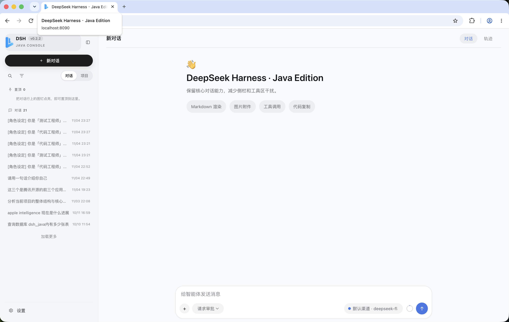

# dsh-java-release（0.2.2）

[中文](./README.md) | [English](./README.en.md)

基于 DSH Java 0.2.2 的可发布运行环境，可直接下载发布和运行

## 命令清单

| 命令 | 用途 | 常用参数 |
| --- | --- | --- |
| `./package.sh` | 组装 `dist/`：从 `../dsh-java`、`../dsh-java-plugins` 的 `target` 直接拷贝构件（**release 内不执行 Maven 构建**） | `--version 0.2.2`、`-h` |
| `./start-local-jar.sh` | 本地 standalone 模式启动（内置 H2，免 MySQL）；`dist/` 不存在时自动调用 `package.sh` | `--rebuild`、`DSH_JAVA_OPTS="-Xmx2g"` |
| `./start-mysql-jar.sh` | MySQL 模式启动（默认数据源）；`dist/` 不存在时自动调用 `package.sh` | `--rebuild`、`DSH_JAVA_OPTS="-Xmx2g"` |
| `dist/start.sh` | `dist/` 运行目录的底层启动脚本，参数透传 Spring Boot | `--app=mysql\|mall\|oceanbase\|dameng`、`--spring.profiles.active=standalone`、`JAR_PATH=...` |

### 环境变量

| 变量 | 作用 | 默认值 |
| --- | --- | --- |
| `RELEASE_VERSION` | `package.sh` 使用的 release 版本 | `0.2.2` |
| `DSH_JAVA_DIR` | dsh-java 源码目录 | `../dsh-java` |
| `PLUGINS_DIR` | dsh-java-plugins 源码目录 | `../dsh-java-plugins` |
| `JAVA_HOME` | JDK 17+ 路径 | 系统 `java` |
| `JAR_PATH` | `dist/start.sh` 指定启动 jar | `./dsh-java-app.jar` |
| `DSH_JAVA_OPTS` | 追加 JVM 参数 | 空 |

## 一键打包

release 内不执行 Maven 构建，直接从相邻仓库的 `target` 拷贝构件（默认版本 0.2.2）：

```bash
./package.sh                    # 拷贝默认版本 0.2.2
./package.sh --version 0.2.2     # 指定 release 版本
```

产物布局：

```text
dsh-java-app.jar        dsh-java 主程序（exec fat jar）
apps/                   四个插件的 app（exec fat jar，可独立运行）
plugins/                四个数据库插件 + sample-tools-plugin（Harness install-root）
dist/                   运行目录
├── dsh-java-app.jar
├── apps/
│   ├── dsh-java-mysql-app.jar       (8091)
│   ├── dsh-java-mall-app.jar        (8092)
│   ├── dsh-java-oceanbase-app.jar   (8093)
│   └── dsh-java-dameng-app.jar      (8094)
├── plugins/            四个数据库插件 + sample-tools-plugin.jar（plugins.install-root）
├── workspaces/         空目录，workspace.root（会话工作区）
└── start.sh
```

## 启动

```bash
./start-local-jar.sh              # 本地模式（standalone，内置 H2）
./start-mysql-jar.sh              # MySQL 模式（默认数据源）
./start-local-jar.sh --rebuild    # 强制重新组装 dist/ 后再启动
dist/start.sh [args]              # 直接启动，参数透传给 Spring Boot
dist/start.sh --app=mysql         # 启动 apps/ 下的插件应用（mysql/mall/oceanbase/dameng）
```

环境变量：`JAVA_HOME`、`DSH_JAVA_OPTS`（额外 JVM 参数）、`JAR_PATH`（指定其他 jar）。

控制台：<http://127.0.0.1:8090>

---

## 系统效果界面

> 截图位于仓库 `assets/` 目录，点击下方链接可直接查看原图。

[](assets/0.主界面.png)

| 场景 | 预览 |
| --- | --- |
| 主界面 | [查看](assets/0.主界面.png) |
| 输入框 | [查看](assets/3.输入框.png) |
| 对话轨迹（工具调用 / 审批） | [查看](assets/5.对话轨迹.png) |
| 设置 · 模型 | [查看](assets/1.设置-模型.png) |
| 设置 · 数字人 | [查看](assets/1.设置-数字人.png) |
| 设置 · 飞书 Bot | [查看](assets/1.设置-飞书Bot.png) |
| 设置 · 技能 Skill | [查看](assets/2.设置-技能Skill.png) |
| 设置 · CLI 子智能体 | [查看](assets/2.设置-CLI子智能体.png) |
| 设置 · MCP | [查看](assets/2.设置-MCP.png) |
| 设置 · 插件 | [查看](assets/2.设置-插件1.png) · [查看](assets/2.设置-插件2.png) |
| 插件使用 · MySQL 插件 | [查看](assets/4.插件使用-mysql插件.png) |

## 为什么选择 DSH Java

**一个可独立运行的 Agent Harness，而不是又一个聊天壳。**

- 🧠 **ReAct 智能体循环**：Reason → Act → Observe，工具调用自动续步，单 turn 最多 50 步
- 🧰 **真实工具能力**：文件读写、Shell 执行、Web 搜索/抓取、用户提问，统一 `ToolCallExecutor` + PRE/POST Hook
- 🧩 **双模式插件**：Java 原生（JAR/SPI，进程内隔离）+ Node sidecar（JSON-RPC），并支持 MCP 工具
- 🛡️ **审批与治理**：提交期权限矩阵评估 + 人工审批，高风险工具（Shell、写文件、插件、子进程）默认需审批
- 💾 **事件溯源**：会话、任务、审批、目标全程落库，可回放、可审计
- 🖥️ **零构建 Web 控制台**：原生 JS，打开浏览器即可对话、管理工作区、审批任务、查看插件与模型
- 📦 **开箱即用**：H2 本地模式零外部依赖；MySQL / Docker Compose 一条命令切换
- 🔌 **可替换基础设施**：端口-适配器架构，数据库、LLM、执行环境均可替换

## 内置 Skills（开箱即用）

`skills/` 目录内置 3 个技能包，在 Web 控制台「设置 → Skills」上传对应 zip 即可使用：

| Skill | 版本 | 能力 |
| --- | --- | --- |
| `dsh-onto-team` | 1.1.0 | 本体库专家团：1 主理人 + 5 团员（指标 / 静态本体 / 动态本体 / 问数 / 可视化），覆盖本体库建设全链路 |
| `md-wecan` | 1.1.0 | MD 工具助手：把 MD/TXT/PDF/网页整理为苹果风 MD，一键导出网页、公众号稿、打印 PDF、分享海报 |
| `read-smart` | 1.0.0 | 智能阅读助手：读懂网页 / HTML / MD / TXT 后重组表达，TTS 生成 mp3 + 字幕 + 高亮同步播放器 |

## 一分钟上手

```bash
# 1. 组装运行目录（直接拷贝 0.2.2 构建产物，不跑 Maven）
./package.sh

# 2. 本地模式启动（内置 H2，无需 MySQL）
./start-local-jar.sh

# 3. 打开控制台
open http://127.0.0.1:8090
```

需要 MySQL：`./start-mysql-jar.sh`；需要独立运行某插件：`dist/start.sh --app=mysql`。

## 适用场景

- **本地智能体工作台**：浏览器 UI、SSE 对话、Markdown 渲染、会话与工作区管理
- **Java 原生 Agent 运行时**：Spring Boot 装配、ReAct Loop、工具注册与执行、会话事件
- **企业内部扩展平台**：Java SPI / Node sidecar / MCP / 插件生命周期 API
- **任务自动化系统**：任务、队列、审批、目标、计划、待办、工作流、后台作业

> 定位：单实例 Agent 运行时，不是开箱即用的分布式多租户 SaaS；生产化部署前需按企业要求补充鉴权、审计、集群协调、可观测性与完整集成测试。

## 版权

[MIT 1.0 © dsh-java-release 2026](./LICENSE)